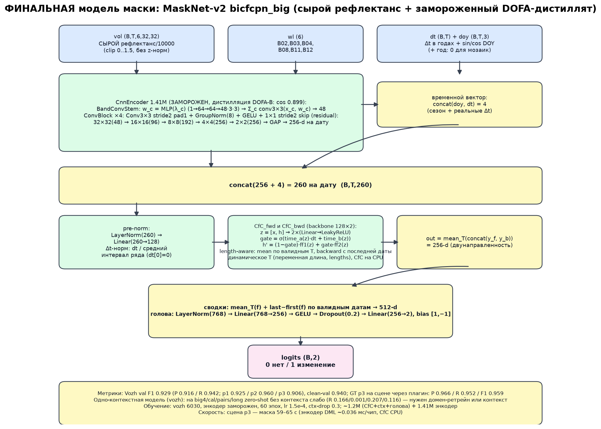
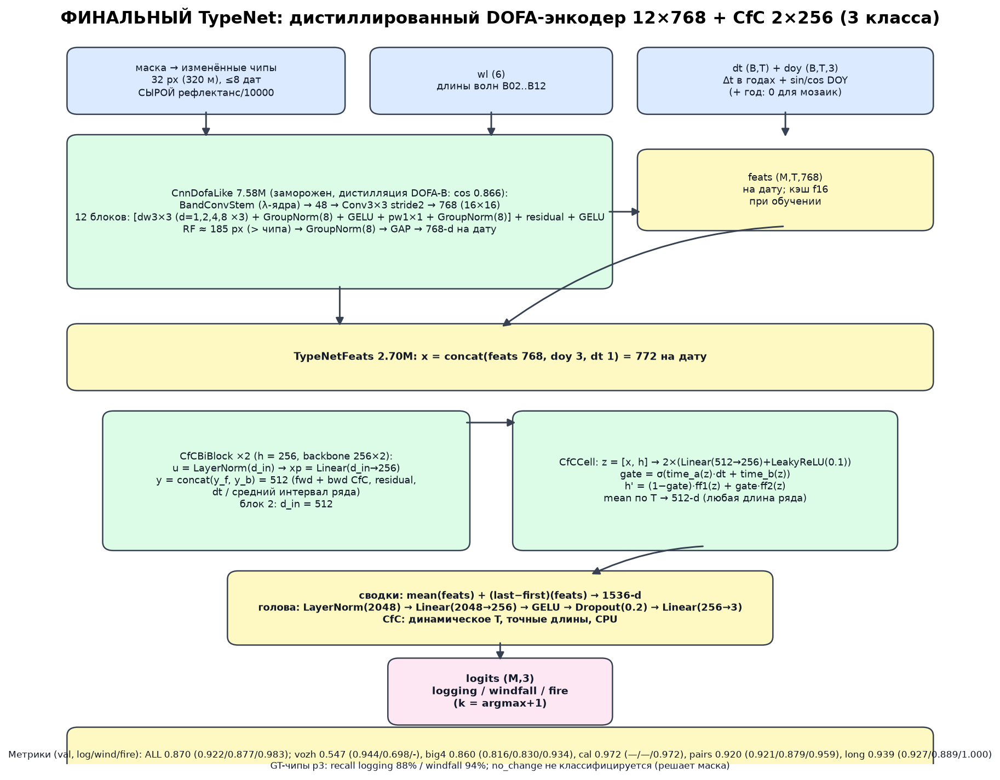

# Forest Change — trained models (final)

Финальные модели задачи выявления и классификации лесных изменений (вырубка / ветровал /
пожар) по Sentinel-2 для QGIS-плагина [`forest-change-qgis`](https://github.com/excelsllor/forest-change-qgis).
Обе финальные модели используют **cross-attention** в вычислительной части (энкодеры — CNN).

Два шага: **маска изменения** (бинарно) → **тип** (logging / windfall / fire).

| модель | чекпоинт | размер |
|---|---|---|
| Маска (cross-attention контекст 3×3 + length-aware CfC) | `mask_ctx_attn3_len.pth` | 4.4 МБ |
| TypeNet (DOFA-дистиллят 12×768 + cross-attention readout) | `typenet_big_w256_b2_attn.pth` | 8.9 МБ |
| **TypeNet Vozh-тюнинг (+9 текстурных признаков)** — по умолчанию в плагине | `typenet_vozh_attn_tex.pth` | 8.9 МБ |
| Энкодеры (дистилляция DOFA-B) | `encoder_dofa_distilled.pth`, `encoder_dofa_distilled_big.pth` | 5.4 + 29 МБ |

Подробные послойные описания и схемы: **[MODEL_MASK_ARCH.md](MODEL_MASK_ARCH.md)**,
**[MODEL_TYPES_ARCH.md](MODEL_TYPES_ARCH.md)**, диаграммы в [docs/](docs/).





---

## 1. Маска: `mask_ctx_attn3_len.pth`

**Входы:** `vol` (B,T,6,32,32) — сырой рефлектанс/10000 (clip 0..1.5, без z-норм);
`dt` (B,T) — годы между датами; `doy` (B,T,3) — (sin DOY, cos DOY, год−2015; для мозаик год=0);
`lengths` (B,) — число валидных дат; **T динамическое** (2..8).
**Архитектура:** CnnEncoder (1.41M: λ-стем + 4 ConvBlock 48→96→192→256→256, GAP → 256-d/дата) +
**контекст 3×3 через cross-attention** (центр — query, 9 соседей — keys/values, 8 голов,
маскировка невалидных соседей, residual + FFN → 256-d) + двунаправленный CfC (128,
length-aware пулинг: среднее по валидным шагам, обратный проход с последней валидной даты) +
сводки mean/last−first + голова 1280→256→2.
**Обучение:** Vozh 6030 чипов, сплит по кварталам, энкодер заморожен; 60 эпох, lr 1.5e-4,
ctx-drop 0.3; ранний стоп только при явном переобучении (после 30-й эпохи).

Метрики на всех датасетах (val, бинарно; P/R/F1):

| датасет | n | pos | P | R | F1 | примечание |
|---|---|---|---|---|---|---|
| **vozh** (с контекстом) | 1321 | 886 | 0.951 | 0.907 | **0.929** | целевой домен |
| vozh (пустой контекст) | 1321 | 886 | 0.944 | 0.887 | 0.914 | fallback-режим |
| big4 (DISFOR pairs) | 9600 | 9600 | 1.000 | 0.211 | 0.348 | zero-shot |
| california | 3973 | 1471 | 0.000 | 0.000 | 0.000 | zero-shot |
| pairs (DISFOR) | 439 | 266 | 0.582 | 0.241 | 0.340 | zero-shot |
| long (DISFOR, T≤8) | 491 | 335 | 0.656 | 0.188 | 0.292 | zero-shot |

- Vozh по периодам: p1 0.922 / p2 0.959 / p3 0.917; clean-val (без пересечения окон кварталов) **0.947**.
- GT p3 через пайплайн плагина (labeled chips): P 0.982 / R 0.967 / **F1 0.975** (p3 val-подмножество: 0.917).
- Модель обучена на Vozh; zero-shot на DISFOR/California без контекста слабый — для других
  регионов нужно дообучение.
- Скорость: энкодер 0.036 мс/чип (DML, батч 512); вся сцена p3 (98 тайлов) — **42–65 с**
  (энкодер DML + CfC на CPU).

## 2. Тип: `typenet_big_w256_b2_attn.pth`

**Входы:** `feats` (M,T,768) — замороженный дистиллированный энкодер CnnDofaLike (λ-стем +
12 depthwise-separable слоёв ×768, дилатации [1,2,4,8]×3, RF≈185); `dt` (M,T) — годы;
`doy` (M,T,3). **T динамическое** (2..8, точные длины).
**Архитектура:** **cross-attention readout** — 2 обучаемых query-токена cross-attend к датам
(8 голов, маска валидных дат, 2 блока: attention + FFN, residual/LayerNorm), 512-d;
сводки mean/last−first (1536) → голова 2048→256→3. CfC-рекуррентности нет.
**Обучение:** vozh 6030 + big4 45000 + california 3313 + пары 2079 + длинные 2307 (изменённые чипы,
3 класса, без no_change); 60 эпох, bs 32, lr 2e-4, CE с весами классов, AUG ×6 для vozh/pairs/long.

Метрики (val, per-class F1):

| датасет | n | logging | windfall | fire | macro |
|---|---|---|---|---|---|
| **все** | 9875 | **0.947** | **0.938** | **0.973** | **0.911** |
| vozh | 886 | 0.949 | 0.693 | — (n=1) | 0.547 |
| big4 (DISFOR) | 7200 | 0.859 | 0.910 | 0.935 | 0.901 |
| california | 1471 | — | — | 0.987 | 0.987 |
| pairs (DISFOR) | 266 | 0.964 | 0.945 | 1.000 | 0.970 |
| long (DISFOR) | 52 | 0.900 | 0.857 | 1.000 | 0.919 |

**Vozh по всем классам** (val, n=886, accuracy 0.912):

| класс | n | precision | recall | F1 |
|---|---|---|---|---|
| logging | 746 | 0.934 | 0.965 | 0.949 |
| windfall | 139 | 0.765 | 0.633 | 0.693 |
| fire | 1 | 0.000 | 0.000 | 0.000 |

- GT-чипы p3 через пайплайн плагина: accuracy 0.799; logging F1 0.875 (recall 0.791),
  windfall F1 0.824 (recall 0.821), fire 0.750 (n=4).
- Слабое место: vozh windfall (0.693, 139 val / 291 train).
- Скорость: энкодер ~2.4 мс/чип-дата (DML); типы p3 (13 385 клеток) — **~140 с cold**
  (attention readout на CPU; кэш фич в `out_dir/cache`).

### Ветровал: почему 0.69 и что даёт Vozh-тюнинг

- В vozh val **52 из 139** windfall уверенно уходят в logging. Визуально это сильные
  ветровалы/санитарные рубки, близкие к вырубке (см. `docs/windfall_montage.png`); доля
  ветровала в чипе у пропущенных **0.18** против **0.09** у верных. Порог/калибровка не помогают
  (max windfall F1 0.703), spectral indices — 0.664, spatial context — 0.675.
- **Vozh-тюнинг** (только vozh, 6030 чипов, без мульти-датасетного микса) + **9 текстурных
  признаков** B08 (4-бин гистограмма ориентаций градиента, энтропия, анизотропия, edge density,
  std, |grad|) — `typenet_vozh_attn_tex.pth`:
  val **acc 0.933**, logging P 0.949 / R 0.975 / **F1 0.962**,
  windfall P 0.833 / R 0.719 / **F1 0.772** (было 0.693).
  E2E p3: windfall **F1 0.865** (p3 val 0.595), logging 0.895, fire 0.857.
- Итог: текстура даёт +0.079 к windfall; для **>0.9** нужен новый сигнал — Sentinel-1 (VV/VH),
  даты сразу после шторма (до санитарной рубки) или более чистые метки причины. Текущие
  6 каналов / 2–4 сезонные даты / 320 м этого не позволяют.

## 3. Код (`code/`)

| файл | что это |
|---|---|
| `masknet_v2.py` | CnnEncoder (маска), BandConvStem, ConvBlock, MaskNetV2 |
| `cfc.py` | CfCCell, CfCBiEncoderPN (length-aware), CfCBiStack |
| `typenet_v3.py` | CnnDofaLike (энкодер типов) |
| `typenet_big.py` | TypeNetFeats + AttnReadout (cross-attention к датам) |
| `exp_ctx_mask.py` | FeatMaskNet: CtxAttn (cross-attention к соседям) + тренер маски |
| `build_vozh_ctx.py` | контекстный датасет маски (сетка фич малого энкодера) |
| `train_big.py`, `distill_encoder.py` | обучение маски и дистилляция энкодера |
| `train_typenet_big.py`, `extract_typenet_feats.py`, `eval_typenet_big.py` | TypeNet: тренер, кэш фич, оценка |
| `eval_mask_all.py` | оценка маски на всех датасетах |
| `eval_clean_pair.py`, `check_dataflow.py` | clean-val маски и проверки dt/ctx-drop/радиометрии |
| `exp_typenet_tex.py` | Vozh-тюнинг TypeNet + 9 текстурных признаков (ветровал) |
| `windfall_diag.py`, `windfall_montage.py`, `windfall_fraction.py` | диагностика ветровала: confusion/уверенность, монтаж, доли пикселей |
| `export_onnx_mask_ctx.py`, `export_onnx_new.py` | экспорт моделей для плагина |
| `draw_arch.py` | блок-схемы архитектур |

**Воспроизведение:**
```bash
python code/build_vozh_ctx.py --with-big-center       # контекстные датасеты
python code/exp_ctx_mask.py --ctx attn --k 3 --tag len  # маска (cross-attention)
# опционально: --cont sep — LayerNorm только по 512 эмбеддингам, скаляры через MLP
# (эксперимент: val 0.934 / clean 0.946 против 0.929 / 0.947 у inline)
python code/train_typenet_big.py --width 256 --blocks 2 \
    --head-width 256 --head-mode summary --readout attn # TypeNet
```

**Данные:** Vozh — `dataset.csv` + мозаики `outputs/vozh/mosaic`; DISFOR — `G:/datasets/unified/big4_chips.npz`;
California — `california.npz`; длинные ряды — `binary_long.npz`; пары — `binary_ds.npz`;
кэши фич типов — `tn_{vozh,big4,cal,pairs,long}.npz`.

**Радиометрия (важно):** все обучающие входы — L2A DN/10000 из мозаик **без применения
BOA_ADD_OFFSET (−1000)**, т.е. в значениях остаётся +0.1. `clip 0..1.5` применяется после `/10000`
и до энкодера (`sanitize` в `distill_encoder.py`/`extract_typenet_feats.py`, `clip` в
`build_vozh_ctx.py`, clamp внутри ONNX-энкодера). Маска и TypeNet используют одну и ту же
конвенцию — не подавайте им offset-corrected рефлектанс без приведения (+0.1).

## Примечания

- Предыдущие варианты (conv-контекст маски, CfC-readout TypeNet, MaskNet-CK, TypeNet-CK,
  production 3D-CNN+CfC, fusion DOFA+CfC) удалены из репозитория.
- Воспроизводимость: детерминированные сиды (0), скрипты в `code/`, конфиги — в CLI-аргументах.
